# 🧆 미트볼 4

실리태번 채팅 옆에 두는 작은 폰입니다. 1세대 상태창 · 2세대 미트볼폰 · 3세대 상태창 3, 그리고 따로 깔던 선택지 · 연락 · 지시창을 **확장 하나**로 합쳤습니다.
쓰고 싶은 기능만 앱으로 켜고, **안 켠 앱은 AI에 아무것도 보내지 않습니다**(글 0 · 호출 0).

<p>
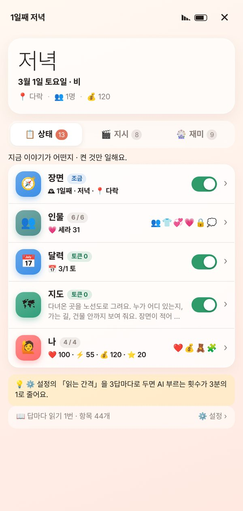 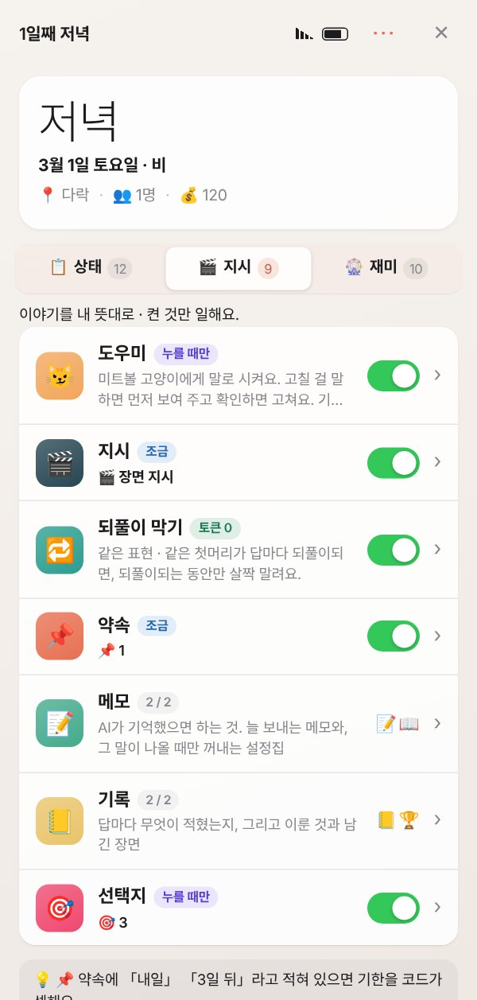 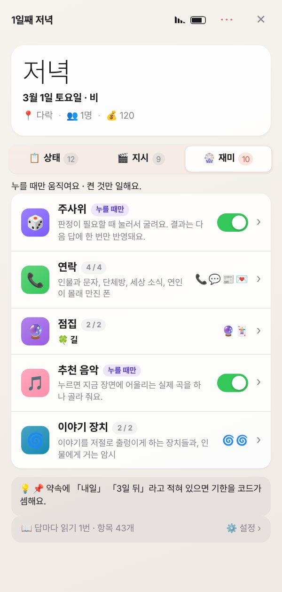
</p>

> 화면의 이름 · 장소 · 대사는 전부 설명용으로 지어낸 것입니다.

## 설치

실리태번 확장 메뉴 › 「Install extension」에 이 주소를 넣습니다.
```
https://github.com/dfzfs/meatballstats4
```
그다음 실리태번을 새로 고침하고, 입력창 옆 🪄 메뉴에서 **「🧆 미트볼」**을 누릅니다. 처음 한 번 「어떤 롤플을 해요?」를 묻고, 고른 것에 맞는 앱만 켭니다.

> 1 · 2 · 3세대 미트볼을 쓰고 있었다면 그쪽은 꺼 주세요. 같이 켜면 AI에 쪽지가 두 번 들어갑니다.

## 1 · 2 · 3세대와 달라진 점

| | 1 · 2 · 3세대 | 미트볼 4 |
|---|---|---|
| 설치 | 세대마다 따로. 2세대는 폰 · 선택지 · 연락, 3세대는 상태창 · 지시창을 각각 | **확장 하나** |
| 기능 고르기 | 확장을 통째로 켜고 끔 | **앱 하나씩** 켜고 끔. 끈 앱은 프롬프트에 안 들어감 |
| 답 읽기 | 세대마다 방식이 다름 | 켠 앱이 몇 개든 답 하나에 **한 번** |
| 묻는 항목 | 정해진 목록을 매번 물음 | **해당될 때만** 물음 (먹는 장면이 있을 때만 「먹었나」, 두 사람이 있을 때만 관계) |
| 더 아끼기 | — | **읽는 간격**: 2답 · 3답을 모아 한 번에 (호출 ½ · ⅓) |
| 셈 · 판정 | 일부는 AI에 맡김 | 돈 · 욕구 · 기한 · 주사위 · 운세 · 호감 점수는 **코드가 셈** |
| 옛 기록 | — | 「📦 이어 가기」 한 번이면 그대로 이어받음 (AI 호출 없음) |

## 채팅 화면에서 보이는 것

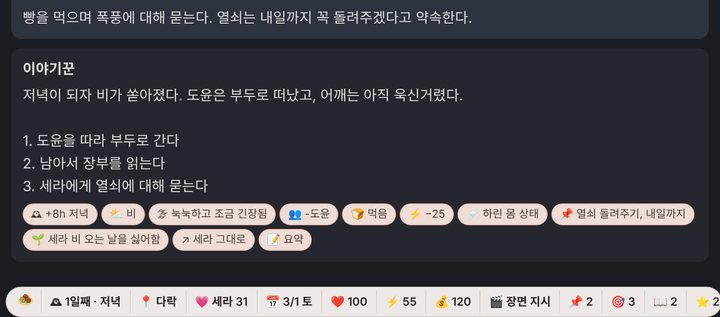

- **답 밑 딱지**: 그 답에서 무엇이 바뀌었는지 (🕰 시간 · 📍 장소 · 💰 돈 · 📌 약속 …). 누르면 📒 기록이 열립니다.
- **입력창 위 상태 줄**: 지금 날 · 장소 · 호감 · 수치 · 돈 같은 것을 한 줄로. 누르면 그 앱이 열립니다.

## 화면

| | | |
|---|---|---|
| 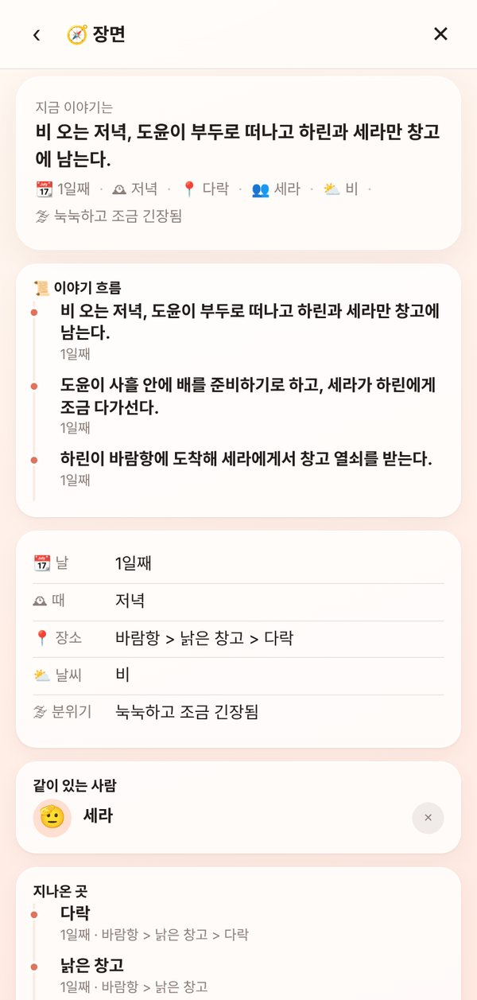 | 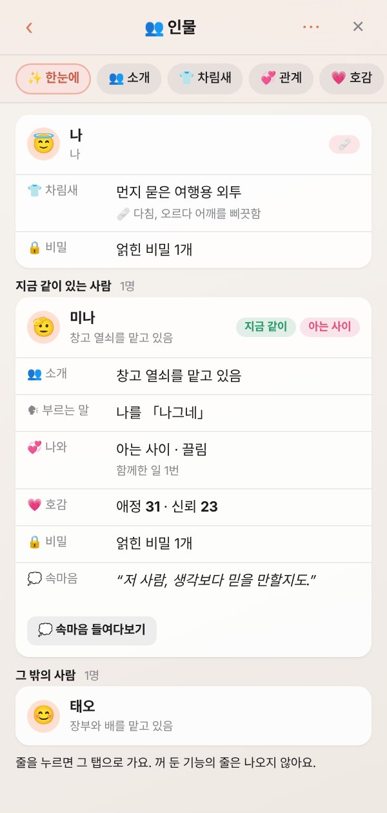 | 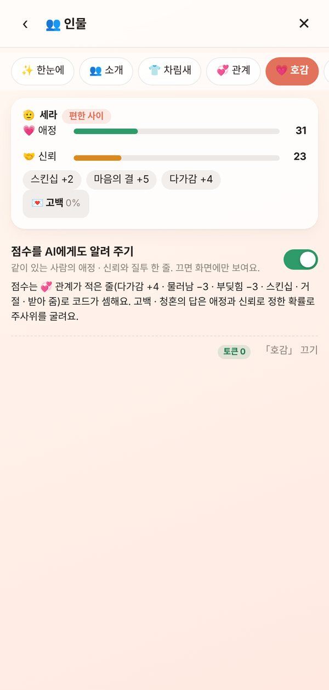 |
| **🧭 장면** — 「지금 이야기는」 한 줄 요약과 흐름, 날 · 때 · 장소 · 날씨 · 분위기 | **👥 인물 한눈에** — 사람마다 한 장. 소개 · 부르는 말 · 차림새 · 관계 · 호감 · 비밀 · 속마음 | **💗 호감** — 관계가 적은 것을 받아 애정 · 신뢰 · 질투를 코드가 셈. 고백 · 청혼 · 이별 카드 |
| 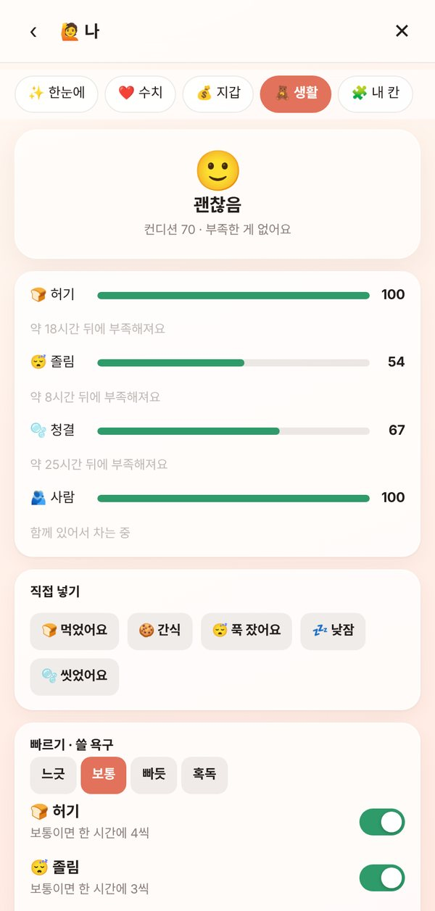 | 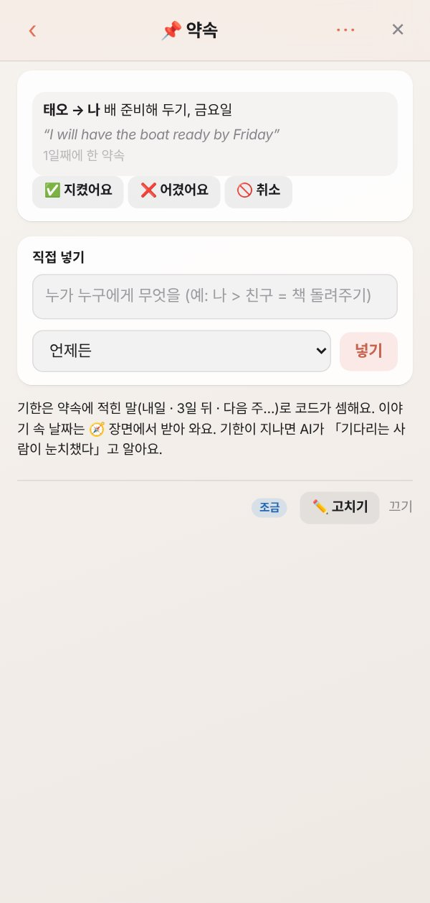 | 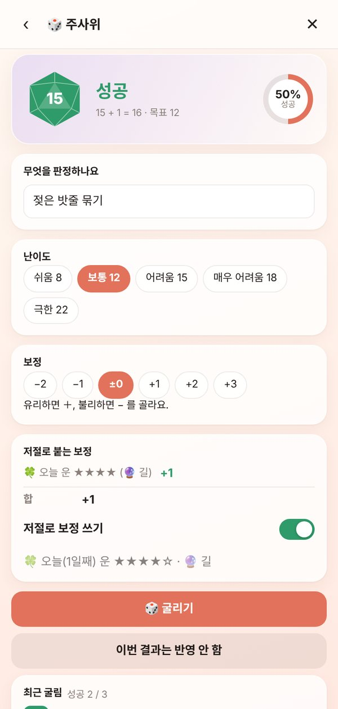 |
| **🧸 생활** — 시간이 흐르면 허기 · 졸림 · 청결 · 사람이 줄고, 언제 부족해지는지 미리 보여 줌 | **📌 약속** — 「내일까지」 「3일 안에」를 코드가 셈해 기한을 붙임. 지나면 AI도 앎 | **🎲 주사위** — 수치 · 생활 · 오늘의 운이 보정으로 붙고 내역이 보임. AI 호출 없음 |
| 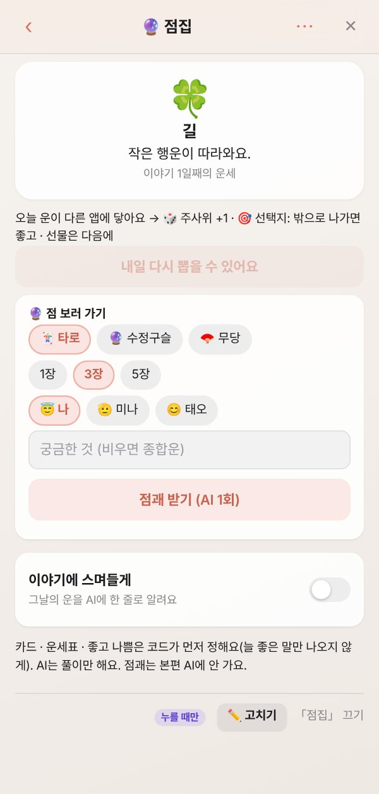 | 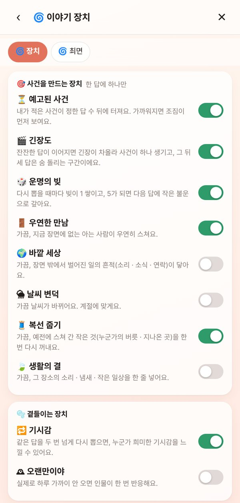 | 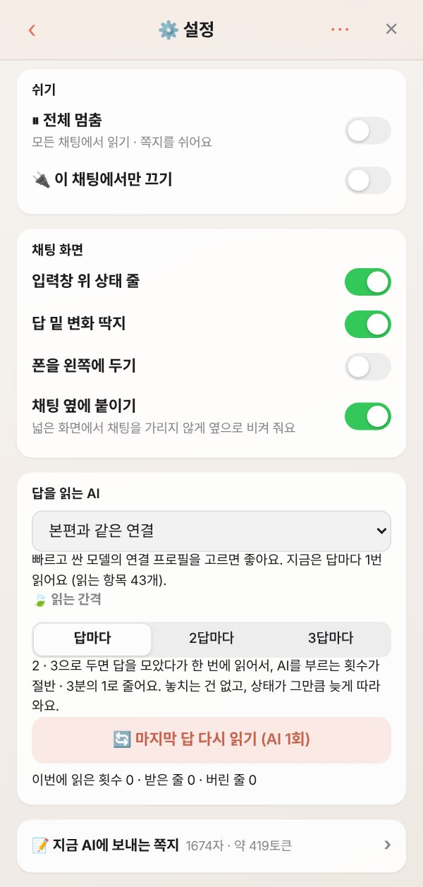 |
| **🔮 점집** — 하루 한 번 운세. 뽑은 운이 주사위 · 선택지에 같이 닿음 | **🌀 이야기 장치** — 예고된 사건 · 긴장도 · 우연한 만남 등 10가지. 한 답에 하나만 | **⚙️ 설정** — 읽는 간격, 📏 토큰 미터(앱마다 몇 글자 보내는지) |

## 앱 목록

딱지: **토큰 0** AI를 더 부르지 않음 · **조금** 답을 읽을 때 항목이 조금 늘어남 · **누를 때만** 단추를 누를 때만 AI 1번

| 묶음 | 줄 | 안에 든 앱 |
|---|---|---|
| 📋 상태 | 🧭 장면 | 장면 (조금) |
| | 👥 인물 | 인물 · 차림새 · 관계 · 호감 · 비밀 (조금) / 속마음 (누를 때만) |
| | 📅 달력 | 달력 (토큰 0) |
| | 🗺 지도 | 지도 (토큰 0) |
| | 🙋 나 | 수치 · 지갑 · 생활 · 내 칸 (조금) |
| 🎬 지시 | 🎬 지시 | 지시 (조금) |
| | 🔁 되풀이 막기 | 되풀이 막기 (토큰 0) |
| | 📌 약속 | 약속 (조금) |
| | 📝 메모 | 메모 · 설정집 (토큰 0) |
| | 📒 기록 | 기록 · 앨범 (토큰 0) |
| | 🎯 선택지 | 선택지 (누를 때만) |
| 🎡 재미 | 🎲 주사위 | 주사위 (AI 0) |
| | 📞 연락 | 문자 · 단체방 · 소식 (누를 때만) · 💌 연인의 손길 (토큰 0) |
| | 🔮 점집 | 점집 · 운명 카드 (AI 0, 점괘만 누를 때) |
| | 🎵 추천 음악 | 추천 음악 · 한 구절 (누를 때만) |
| | 🌀 이야기 장치 | 장치 10가지 · 최면 (토큰 0) |

모두 30개입니다. 처음엔 고른 묶음에 맞는 것만 켜집니다.

## 부하

- 끈 앱은 코드도 불러오지 않습니다.
- 켠 앱이 여럿이어도 **답을 읽는 호출은 답마다 1번**이고, 앱들이 그 한 번을 나눠 씁니다.
- 읽는 AI는 ⚙️ 설정에서 **빠르고 싼 모델의 연결 프로필**로 따로 고를 수 있습니다.
- 「읽는 간격」을 2 · 3답마다로 두면 호출이 절반 · 3분의 1로 줄어듭니다. 놓치는 답은 없고, 상태가 그만큼 늦게 따라옵니다.
- 지금 몇 글자를 보내는지는 ⚙️ 설정 › 📏 토큰 미터에 앱마다 나옵니다.

## 옛 미트볼에서 옮겨 오기

- **옛 미트볼을 쓰던 채팅**: 첫 화면의 「📦 이어 가기」를 누르면 상태창 · 미트볼폰 · 상태창 3의 기록을 그대로 이어받습니다. 비밀 · 지시 · 메모는 처음 열 때 저절로 옵니다.
- **미트볼 없이 하던 채팅**: 「📖 한 번에 읽기」로 처음부터 채웁니다(답 3개씩 묶어 읽기).
- **💾 백업**: ⚙️ 설정에서 이 채팅의 기록과 설정을 파일로 받고 되살릴 수 있습니다.


